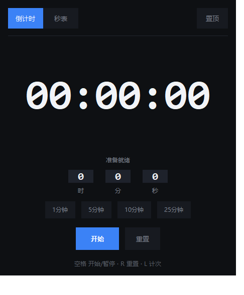
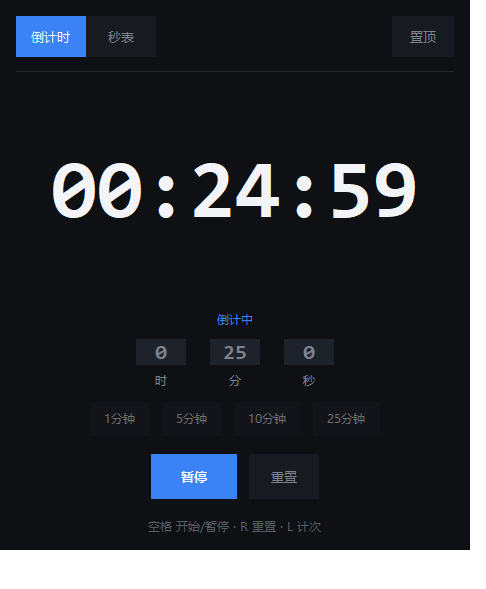
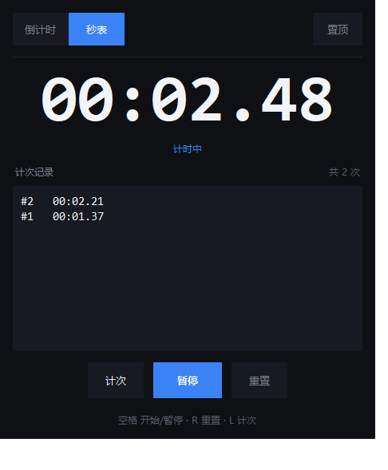

# Dark Timer

深色极简风的 Windows 桌面计时器 | A dark, minimal desktop timer for Windows

- ⏱ **倒计时**：快捷时长、暂停/继续，到点**声音 + 弹窗提醒**
- 📊 **任务栏进度条**：倒计时进度直接显示在任务栏图标上，从满逐渐退到空；
  暂停变黄、到点变红
- 🔔 **到点图标闪烁**：时间到后任务栏图标持续闪烁提醒，点开窗口即停止
- 🏃 **秒表**：精确到 0.01 秒，支持**计次**记录
- 📌 **窗口置顶**开关（点击开启，再点取消）
- ⌨️ 快捷键：`空格` 开始/暂停 · `R` 重置 · `L` 计次
- 📦 单文件 exe（约 9 MB），双击即用，**无需安装 Python**
- 🐍 Python + Tkinter 编写，主程序单文件，附 52 项自动测试；
  任务栏功能用纯 `ctypes` 调 Windows API（`ITaskbarList3` + `FlashWindowEx`），零第三方依赖

Taskbar progress bar that drains during countdown (turns yellow on pause, red at
zero) · Taskbar icon flashing when time is up · Countdown with sound & popup
alerts · Stopwatch with lap tracking · Always-on-top toggle · Single portable exe ·
Python + Tkinter, zero dependencies · tested (52 assertions)

## 界面预览

| 倒计时 | 倒计中 | 秒表 |
|---|---|---|
|  |  |  |

## 下载使用

从 **[Releases](../../releases)** 页面下载 **`timer.exe`**（约 9 MB），双击运行——
无需安装、无需 Python 环境，可拷贝到任意 Windows 电脑。

## 从源码运行 / 打包

```powershell
# 直接运行源码
python timer.py

# 运行功能测试（52 项自动断言）
python _dev\test_timer.py

# 重新打包成 exe（--add-data 必须带上，否则窗口图标丢失）
python -m PyInstaller --noconfirm --onefile --windowed `
    --name "计时器" --icon icon.ico --add-data "icon.ico;." timer.py
```

> 发布到 GitHub Release 时，建议把文件重命名为英文 `timer.exe` 再上传，
> 避免中文文件名在部分系统/下载工具下出现乱码。

## 项目结构

```
dark-timer/
├── timer.py            # 主程序（界面 + 全部逻辑，单文件）
├── icon.ico            # 应用图标（深色底蓝色表盘）
├── README.md
├── .gitignore
├── screenshots/        # README 展示截图
│   ├── shot1_countdown.png
│   ├── shot2_running.png
│   └── shot3_stopwatch.png
└── _dev/               # 开发辅助
    ├── test_timer.py       # 功能自动化测试（52 项）
    ├── layout_check.py     # 布局自检（居中/溢出验证）
    ├── make_icon.py        # 重新生成图标
    ├── shot.py / winshot.py   # 界面截图工具
    ├── probe_taskbar.py    # 任务栏 COM / HWND 探测
    ├── verify_taskbar.py   # 进度条视觉验证（截图差分）
    ├── verify_e2e.py       # 端到端：进度递减 -> 到点闪烁
    └── capture_exe.py       # exe 运行验证
```

> 打包产物 `dist\`、构建缓存 `build\` 已被 `.gitignore` 排除，exe 请发布到
> **Releases** 而不是提交进仓库。
